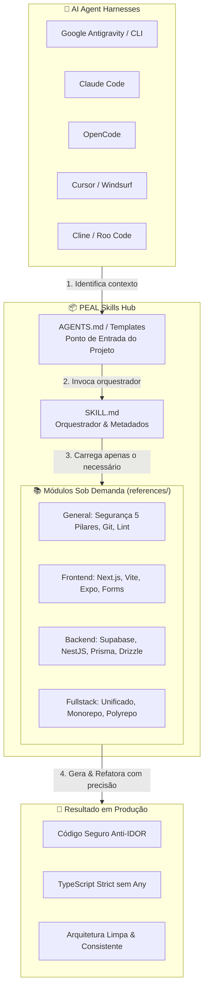

<div align="center">

# 🧠 PEAL Skills
### *Repositório Central de Skills & Engenharia de Contexto para AI Code Agents & Harnesses*

[](#-compatibilidade-com-harnesses)
[-00C853?style=for-the-badge)](#-catálogo-de-skills)
[-3178C6?style=for-the-badge&logo=typescript&logoColor=white)](#-filosofia-de-engenharia)
[](#-os-5-pilares-de-segurança)
[](#-licença)

<p align="center">
  <b>Transforme agentes de IA generalistas em engenheiros de software seniores especializados na sua stack.</b><br/>
  Regras arquiteturais, padrões de produção e fluxos determinísticos carregados sob demanda através de <i>Progressive Disclosure</i>.
</p>

[Catálogo](#-catálogo-de-skills) • [Primeira Skill: project-rules](#-skill-em-destaque-project-rules) • [Como Usar](#-como-utilizar-nos-harnesses) • [Como Funciona](#-arquitetura--progressive-disclosure) • [Criar Nova Skill](#-padrão-para-novas-skills)

---

</div>

## 📌 Visão Geral

Modelos de linguagem para geração de código (LLMs em Coding Harnesses) são incrivelmente velozes, mas sem diretrizes bem estruturadas sofrem com:
- **Alucinação de arquitetura:** Mistura de paradigmas (ex: misturar chamadas de banco no client side, ignorar RLS).
- **Estouro de contexto (Context Bloat):** Fornecer regras gigantescas no prompt inicial consome a janela de contexto e dilui a atenção do modelo.
- **Inconsistência de padrões:** Variáveis em idiomas misturados, tipagens fracas (`any`), falta de contratos de resposta padronizados e vulnerabilidades de segurança básicas (IDOR, falta de validação).

O **`peal-skills`** é um ecossistema modular de **habilidades (skills)** prontas para consumo por harnesses modernos de agentes de IA. Cada skill encapsula inteligência de engenharia, regras de segurança comprovadas em produção, modelos de arquivos e guias de resolução técnica.

---

## ⚡ Arquitetura & Progressive Disclosure

As skills deste repositório adotam o padrão de **Divulgação Progressiva (*Progressive Disclosure*)**: o agente só consome a informação necessária para o arquivo ou tarefa que está a executar, economizando tokens e mantendo a taxa de acerto no topo.



---

## 🗂️ Catálogo de Skills

| Skill | Status | Descrição | Escopo |
| :--- | :---: | :--- | :--- |
| [`project-rules`](./project-rules/) | 🟢 **Ativa** | Guardião central de arquitetura, segurança (5 Pilares), tipagem estrita e convenções para Fullstack, Backend e Frontend. | Universal / Multi-stack |

---

## 🔌 Compatibilidade com Harnesses

Esta coleção foi concebida para ser **universal e agnóstica**, integrando-se perfeitamente aos principais ambientes de agentes:

| Harness | Como o Agente consome as Skills | Suporte |
| :--- | :--- | :---: |
| **OpenCode** | Descoberta direta de diretrizes via `AGENTS.md` na raiz do repositório ou referenciando o `SKILL.md` nas sessões. | 🟢 Nativo |
| **Google Antigravity (AGY)** | Descoberta automática via `.agents/skills/`, CLI ou configuração global (`~/.gemini/antigravity-cli/skills`). | 🟢 Nativo |
| **Claude Code (Anthropic)** | Carregado através de skills em `.claude/skills/` ou referenciado diretamente no prompt / `CLAUDE.md`. | 🟢 Nativo |
| **Cursor & Windsurf** | Carregamento via regras de workspace (`.cursorrules`, `.windsurfrules`) apontando para `AGENTS.md`. | 🟢 Compatível |
| **Cline / Roo Code (VS Code)** | Custom Instructions e sub-modos configurados com links para as referências das skills. | 🟢 Compatível |
| **Aider & Outros Coding LLMs** | Inclusão de `AGENTS.md` ou `SKILL.md` como arquivos de contexto adicionados ao chat (`/read-only`, flags de contexto). | 🟢 Compatível |

---

## 🚀 Como Utilizar nos seus Projetos

### Método 1: Inicializando um Projeto com a Skill `project-rules`
1. Vá até a pasta [`project-rules/templates/`](./project-rules/templates/).
2. Escolha o template que corresponde à arquitetura do seu projeto (ex: `FULLSTACK-UNIFIED-AGENTS.md`).
3. Copie o arquivo para a raiz do seu projeto de destino com o nome `AGENTS.md`:
   ```bash
   cp project-rules/templates/FULLSTACK-UNIFIED-AGENTS.md /caminho/para/seu-projeto/AGENTS.md
   ```
4. Ao abrir o agente (Antigravity, Claude Code, OpenCode, Cursor, etc.), ele lerá o `AGENTS.md` e saberá exatamente quais regras carregar.

### Método 2: Instalando no Google Antigravity / AGY CLI
Você pode disponibilizar esta skill para todos os seus projetos ou em um workspace específico:
- **No Workspace atual:**
  ```bash
  mkdir -p .agents/skills
  cp -r /caminho/para/peal-skills/project-rules .agents/skills/
  ```
- **Globalmente na sua máquina:**
  ```bash
  cp -r /caminho/para/peal-skills/project-rules ~/.gemini/antigravity-cli/skills/
  ```

### Método 3: No Claude Code
Adicione a pasta da skill ao seu repositório ou configure o `CLAUDE.md` para instruir o Claude a consultar as regras:
```markdown
# Instruções do Projeto
Consulte as regras arquiteturais e de engenharia definidas em:
`path/to/peal-skills/project-rules/SKILL.md`
```

### Método 4: No OpenCode
O OpenCode detecta arquivos de contexto no workspace nativamente. Garanta que o template `AGENTS.md` esteja na raiz do repositório ou referencie a skill explicitamente na sua sessão:
```bash
# Executando tarefas com referência direta às regras
opencode "Implemente a rota seguindo as regras em AGENTS.md e project-rules/SKILL.md"
```

---

## 💎 Filosofia de Engenharia

Todas as skills mantidas neste repositório seguem três mandamentos invioláveis:

> [!IMPORTANT]
> **1. Tipagem Estrita Sem Atalhos:** Proibido o uso de `any`. Tipos primitivos com significado de negócio são protegidos e retornos de ação seguem o contrato unificado `ActionResult<T>`.

> [!TIP]
> **2. Identificadores em Inglês & UI em Português:** Variáveis, funções, classes, schemas e commits são sempre escritos em **Inglês técnico**. Textos visíveis para o usuário final, mensagens de erro e labels de formulário são redigidos em **Português**.

> [!CAUTION]
> **3. Segurança por Padrão (Secure by Default):** Nenhuma query ou mutação é escrita assumindo que os dados de entrada são confiáveis. Todos os acessos passam por verificação de permissão e tenant.

---

## 🛠️ Padrão para Criação de Novas Skills

Deseja adicionar ou propor uma nova skill para o `peal-skills`? Cada nova skill deve seguir a seguinte anatomia:

```text
minha-nova-skill/
├── SKILL.md             # Obrigatório: Frontmatter YAML (name, description) + Guia
├── AGENTS.md            # Documentação amigável e sumário
├── references/          # Módulos com aprofundamento técnico e exemplos
├── templates/           # Arquivos base prontos para cópia (se aplicável)
└── scripts/             # Scripts auxiliares e ferramentas de validação (opcional)
```

### Cabeçalho Obrigatório do `SKILL.md`:
```yaml
---
name: nome-da-skill
description: >-
  Descrição concisa, clara e focada em intenção. Explique exatamente QUANDO
  o agente deve ativar esta skill e quais problemas ela resolve.
---
```

### Registo: `skills.json`

O `skills.json` na raiz do repositório é o índice que os agentes de instalação leem para saber o que existe e o que é obrigatório:

```json
{
  "skills": [
    {
      "name": "project-rules",
      "path": "project-rules",
      "alwaysOn": ["general"],
      "description": "Uma linha, para o seletor de skills."
    }
  ]
}
```

| Campo | Obrigatório | Significado |
| :--- | :---: | :--- |
| `name` | não | Identificador da skill. Por omissão, o nome da pasta. |
| `path` | **sim** | Pasta da skill dentro do repositório. |
| `alwaysOn` | não | Módulos de `references/` a carregar em **qualquer** tarefa que toque código. Por omissão `["general"]`. |
| `description` | não | Uma linha, para quem lista as skills. |

**Porquê `alwaysOn`:** declara aqui o que é universal. O que é específico de um projecto pertence ao `AGENTS.md` desse projecto — não a este repositório. Assim só há uma fonte de verdade para cada decisão.

> Sem `skills.json`, quem instala ainda descobre as skills por varrimento: cada pasta de primeiro nível com um `SKILL.md` é uma skill. O índice só é necessário quando quiseres declarar `alwaysOn` ou mais do que uma skill.

---

## 👥 Autor & Contribuições

Mantido com foco em excelência e produtividade agentic por **PEAL** ([edilasio@live.com](mailto:edilasio@live.com)).

Contribuições, sugestões de novas skills e melhorias de regras são sempre bem-vindas! Sinta-se à vontade para abrir uma issue ou enviar um pull request.

---

## 📄 Licença

Este projeto é distribuído sob a licença **MIT**. Consulte o arquivo [LICENSE](./LICENSE) para mais informações.
